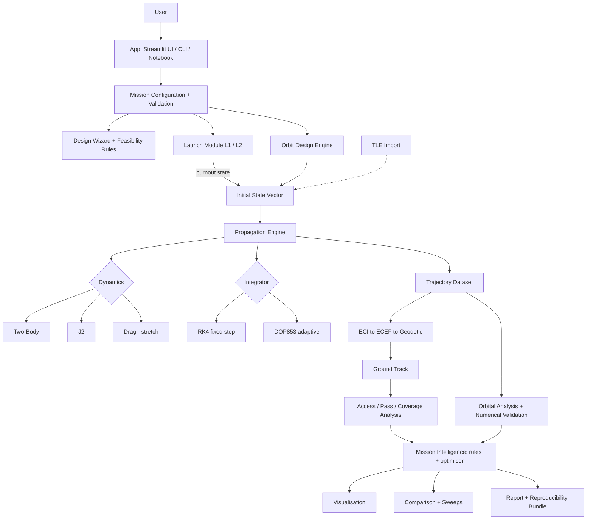

<div align="center">

# 🛰️ SATELLITE PROPAGATION AND ORBITAL INTELLIGENCE

### From Launch Pad to Ground Track — Explained

**An integrated launch simulation, orbit design, propagation and mission analysis platform, delivered as software anyone can install and run**


**Team:** CP · AD · YP &nbsp;|&nbsp; **Level:** Fifth-semester engineering minor project

</div>

---

> **PROJECT NORTH STAR**
>
> Let anyone — a student, an enthusiast, a CubeSat builder, a researcher — design a mission, *launch it* in simulation, watch it reach orbit, propagate it, see its ground track, and learn whether it meets the mission requirement. Every number is traceable to an equation, every warning explains itself, and the whole thing installs with a double-click.

---

# 00 · Document Control and How to Read This

| Item | Value |
|---|---|
| Document | Final Blueprint v2 (supersedes the original ORBITAL INTELLIGENCE blueprint) |
| Formal title | Satellite Propagation and Orbital Intelligence |
| Software name | ORBITAL INTELLIGENCE (a short name; check for collisions before public release) |
| Written | 17 November 2026 |
| Indicative end date | 12 January 2027 (8 weeks, **adjust to your real submission and exam calendar**) |
| Status | Planning baseline. Nothing in this document is validated yet. |

**How this document is organised**

- Sections 01–04: why, what, for whom, and how much.
- Sections 05–07: architecture, data contract and module specifications (the engineering core).
- Sections 08–09: the application and how people install it.
- Sections 10–11: validation and experiments (the part examiners and scientists judge).
- Sections 12–14: repository, team, and the week-by-week plan.
- Sections 15–19: risks, demo, grading strategy, definition of done, appendices.

**Convention.** Where a number below is marked **(proposed)**, it is a starting target that you must confirm or tighten after your first measurements. Where a rocket or mission figure is marked **(illustrative)**, it is a placeholder, not data about a real vehicle.

---

# 01 · Executive Summary and Final Verdict

## 1.1 What the project is

A single connected platform that tells one story:

```
LAUNCH SITE → ASCENT → ORBIT INSERTION → PROPAGATION → GROUND TRACK → COVERAGE → MISSION VERDICT
```

Most student projects do one box in that chain. This one connects all of them, with a physics engine that is independent of the interface, validated against analytical solutions and independent references, and packaged so that a non-programmer can run it.

## 1.2 Final verdict

| Question | Verdict |
|---|---|
| Should this be your minor project? | **Yes**, on the condition that you follow the tier gates in Section 03. |
| Idea strength | 9/10. The launch-to-ground-track arc is distinctive and relevant. |
| Biggest risk | Scope. With launch added, this is large for three people in eight weeks. |
| What makes it outstanding | Quantitative validation, one headline research result, a working installer, and honest modelling. |
| What makes it mediocre | Attempting every feature at shallow depth, with no measured evidence. |
| Name | Keep **Satellite Propagation and Orbital Intelligence** as the formal title. Use **ORBITAL INTELLIGENCE** as the software name. Defend "Intelligence" as *explainable rule-based decision support plus numerical optimisation*, not machine learning. |

## 1.3 The five things that will set it apart

1. **Pad-to-orbit continuity.** The burnout state of the launch simulation becomes the initial state of the propagator automatically.
2. **A headline result with a number.** "How long can a two-body model be trusted for predicting target passes, and when does J2 become necessary?" (Section 11).
3. **Everything explained.** Every output has an "Explain this result" panel showing the equation, inputs and assumptions.
4. **Independent validation.** Analytical Kepler solution, closed-form J2 precession, SGP4 comparison and a published launch profile.
5. **Zero-friction access.** A hosted link, a Windows installer, and a `pip` package, all from one engine.

---

# 02 · Vision, Positioning and Identity

## 2.1 The problem

Free tools exist (GMAT, Orekit, Heavens-Above, STK Free for some uses), but they are either complex to learn, narrow in purpose, or closed. Learners and small teams face a gap:

- Orbit tutorials stop at a trajectory plot.
- Launch calculators are rarely connected to orbit analysis.
- Professional tools do not explain *why* a result is what it is.
- Many tools demand installation skills that newcomers do not have.

## 2.2 Positioning (be honest about it)

**We do not compete on fidelity** with GMAT or STK. We compete on:

| Strength | What it means |
|---|---|
| **Transparency** | Every result traces to an equation and a stated assumption. |
| **Design assistance** | Requirements in, candidate orbits out, with reasons. |
| **Continuity** | Launch, orbit and mission analysis in one workflow. |
| **Accessibility** | Installs with a double-click; beginner mode in plain English. |
| **Trust** | A shipped validation report with measured errors. |

## 2.3 Who it is for

| Persona | Need | What the product gives them |
|---|---|---|
| **Aerospace enthusiast** | Understand how launches and orbits work, see it visually | Presets, plain-English results, animations, glossary |
| **CubeSat or student team** | Pick an orbit, estimate passes, power, downlink time | Orbit designer, ground-station planner, eclipse estimator |
| **Educator** | Demonstrate J2, ground tracks, Δv budgets | Reproducible example missions, exportable figures |
| **Researcher or analyst** | Scriptable, citable, verifiable engine | `pip install` package, CLI, notebooks, validation report |
| **Examiner** | See rigour | Thresholds, convergence plots, independent checks |

## 2.4 Name

- **Formal title (report cover, presentation):** *Satellite Propagation and Orbital Intelligence*.
- **Software name (window title, installer, button):** *ORBITAL INTELLIGENCE*.
- **Tagline:** *From launch pad to ground track, explained.*
- **"Intelligence" defence:** if asked "where is the AI?", the answer is: *explainable rule-based mission decision support and SciPy-based optimisation. We make no machine-learning claim.*
- Before any public release, search for existing products with similar names (for example, companies with "Orbital" in the name exist).

---

# 03 · Scope Tiers and Gates

The scope is deliberately tiered. **You do not start a tier until the previous tier's gate is passed.**

## 3.1 Tier table

| Tier | Contents | Gate to pass before moving on |
|---|---|---|
| **MVP (must ship)** | Data contract; constants and units; orbit design (elements ↔ state); two-body RK4 with analytical validation; J2 with closed-form check; ECI→ECEF ground track; event-based access detection; four-page app; Windows package; **L1 launch calculator** | All MVP acceptance tests pass; install works on a clean laptop |
| **Target** | **L2 ascent simulation with hand-off to the propagator**; headline prediction-horizon experiment; adaptive integrator; SSO, Hohmann and preset orbits; TLE import with SGP4 comparison; mission comparison; PDF report | MVP frozen, tagged and regression-tested |
| **Stretch** | Monte Carlo launch dispersion; design optimiser; launch windows; ground-station planner; eclipse and power estimator; camera GSD calculator; MP4/GIF export | Target stable and documented |

## 3.2 Explicitly out of scope

- High-fidelity atmosphere and density modelling.
- Full precision Earth orientation (nutation, polar motion).
- Attitude dynamics, collision avoidance, conjunction assessment.
- Operational flight software and live satellite tracking.
- 6-DOF rocket dynamics, detailed engine thermodynamics, CFD.
- Machine-learning orbit or trajectory optimisation.

## 3.3 Cut order if time runs short

```
extra pages → drag → Monte Carlo and optimiser → 3D launch view → launch windows → ground stations → eclipse
```

**Never cut:** validation, ground-track correctness, the two-body versus J2 comparison, the clean-machine install test.

---

# 04 · User Journeys

## 4.1 Beginner journey (plain English)

1. Open the app. Pick **"Earth observation over India"** from example missions.
2. The app proposes an orbit and a rocket, and explains why in two sentences.
3. Press **Launch**. Watch the ascent animation, then the orbit appear.
4. See: *"Your satellite reached a 550 km orbit in about 9 minutes and passes over your target about N times in 7 days."* (numbers come from the simulation, not from this document).
5. Press **Explain this result** to see the equations.
6. Export a one-page PDF.

## 4.2 Expert journey

1. Define a mission in JSON or in the UI.
2. Choose gravity model (two-body, J2), integrator (RK4, DOP853), tolerances and epoch.
3. Run from the CLI or a notebook; receive a `SimulationResult` object.
4. Run parameter sweeps; export CSV, JSON and a reproducibility bundle.
5. Read the validation report before trusting the numbers.

## 4.3 Mission engineer journey (requirements to design)

1. Enter target latitude and longitude, altitude limits, and a revisit goal.
2. The **design wizard** checks feasibility (for example, inclination must be at least the target latitude in magnitude), proposes candidate orbits, and ranks them.
3. Pick one, run launch and propagation, compare against alternatives, export.

---

# 05 · System Architecture

## 5.1 Principles (kept from the original, extended)

- **Physics first.** Every displayed result originates from the engine.
- **Engine independent of UI.** The engine runs from a script, a test, a CLI or Streamlit.
- **Reproducibility.** Every run stores its inputs, constants, versions and numerical settings.
- **Traceability.** Every warning cites its rule, measured value and threshold.
- **Testability.** Mathematical functions are testable without the UI.
- **Incremental development.** Existing working code is audited and kept.
- **Honest modelling.** Approximations and limits are visible in every result.

## 5.2 High-level architecture



## 5.3 Layer responsibilities

| Layer | Responsibility | Output |
|---|---|---|
| Interface (Streamlit / CLI) | Collect input, present results | User interaction |
| Mission configuration | Validate and store requirements | `MissionConfig` |
| Design wizard | Requirements to candidate orbits | Ranked designs with reasons |
| Launch module | Ascent to burnout state | `LaunchResult` |
| Orbit design | Elements to state, state to elements | `StateVector`, `Elements` |
| Dynamics | Acceleration models | Acceleration vector |
| Propagator | Integrate state in time | `SimulationResult` |
| Coordinate transforms | Inertial to Earth-fixed to geodetic | Latitude, longitude, altitude |
| Coverage | Passes, access, footprints | Pass list, revisit statistics |
| Analysis | Physical and numerical metrics | Metrics, error reports |
| Mission intelligence | Rules and optimisation | Verdicts, explanations |
| Reporting | Package everything | CSV, JSON, PNG, PDF, bundle |

## 5.4 Global conventions (decide once, never change)

| Topic | Decision |
|---|---|
| Internal length unit | **kilometre** |
| Internal time unit | **second** |
| Internal velocity | **km/s** |
| Internal angle unit | **radian** (degrees only at the UI and file edge) |
| Mass | kilogram (launch module may use tonnes in the UI only) |
| Inertial frame | **ECI, J2000-style Earth-centred inertial (simplified)**; document that precession and nutation are neglected |
| Earth-fixed frame | **ECEF**, via a **simple GMST rotation** (documented as educational-grade) |
| Time scale | **UTC for display**; simulation uses seconds since an explicit epoch; document leap-second handling as neglected |
| Earth model | Sphere for dynamics; **WGS-84 ellipsoid for geodetic latitude, longitude and altitude** |
| Constants | One file, `constants.py`, with source comments (Appendix A) |
| Display time | UTC with an IST toggle |

**Rule:** only the UI layer converts to degrees, minutes or other display units. A test enforces that the engine never receives degrees.

---

# 06 · Data Contract

Agree this **in Week 1** and give YP mock data immediately, so no one is blocked.

```python
from dataclasses import dataclass, field
from typing import Optional, Literal
import numpy as np

@dataclass(frozen=True)
class Elements:                 # classical elements, SI-km-rad
    a_km: float
    e: float
    i_rad: float
    raan_rad: float
    argp_rad: float
    nu_rad: float               # true anomaly at epoch

@dataclass(frozen=True)
class StateVector:              # ECI, km and km/s
    r_km: np.ndarray            # shape (3,)
    v_kms: np.ndarray           # shape (3,)
    epoch_utc: str              # ISO 8601

@dataclass(frozen=True)
class SimulationRequest:
    mission_name: str
    initial_state: StateVector
    gravity_model: Literal["two_body", "j2"]
    integrator: Literal["rk4", "dop853"]
    dt_s: Optional[float]       # RK4 step; None for adaptive
    rtol: Optional[float]       # adaptive tolerance
    atol: Optional[float]
    duration_s: float
    output_step_s: float
    frame: str = "ECI-simplified"
    constants_id: str = "WGS84-EGM2008-v1"

@dataclass
class SimulationResult:
    t_s: np.ndarray             # (N,)
    r_km: np.ndarray            # (N,3)
    v_kms: np.ndarray           # (N,3)
    a_kms2: Optional[np.ndarray]
    request: SimulationRequest
    status: Literal["ok", "warning", "failed"]
    messages: list[str] = field(default_factory=list)
    n_steps: int = 0
    runtime_s: float = 0.0
    versions: dict = field(default_factory=dict)   # python, numpy, scipy, app
    validation: dict = field(default_factory=dict) # energy drift, etc.

@dataclass
class LaunchRequest:
    site_name: str
    site_lat_rad: float
    site_lon_rad: float
    vehicle_id: str                       # preset or custom
    mode: Literal["sizing", "flight"]
    target_perigee_km: float
    target_apogee_km: float
    target_inclination_rad: Optional[float]
    launch_azimuth_rad: Optional[float]
    pitch_program: Optional[list]         # [(t_s, pitch_rad)], optional
    payload_kg: float

@dataclass
class LaunchResult:
    t_s: np.ndarray
    altitude_km: np.ndarray
    downrange_km: np.ndarray
    speed_kms: np.ndarray
    flight_path_angle_rad: np.ndarray
    mass_kg: np.ndarray
    dynamic_pressure_pa: np.ndarray
    alpha_rad: np.ndarray                 # reported, not only commanded
    g_load: np.ndarray
    events: list[tuple[str, float]]       # (name, time_s): max-Q, MECO, ...
    burnout_state: StateVector
    resulting_elements: Elements
    outcome: Literal["orbit", "suborbital", "failed"]
    delta_v_budget: dict                  # ideal, gravity, drag, steering, rotation credit
    propellant_kg: float
    liftoff_mass_kg: float
    time_to_burnout_s: float
    messages: list[str]
```

**Contract rules**

1. AD's analysis functions consume `SimulationResult` and `LaunchResult`; they never re-propagate.
2. YP's UI calls the same engine functions as the CLI and tests.
3. Results serialise to JSON and CSV through one function each.
4. Any change to these classes needs agreement of all three members and a version bump.

---

# 07 · Module Specifications

Each module lists: purpose, inputs, equations, required behaviour, tests and outputs. Original modules 01–09 are preserved and extended; **Module 04 (Launch) and Module 10 (Mission Tools) are new**.

---

## MODULE 01 — Mission Configuration

**Purpose:** convert the user's idea into validated, saved requirements.

**Inputs:** mission name and description; objective; target latitude and longitude or a polygon/circle region; altitude or altitude range; orbit type; inclination; eccentricity or perigee and apogee; RAAN; argument of perigee; initial anomaly (true **or mean**); epoch; duration (default **7 days** for coverage studies); step; dynamics model; optional launch settings; optional minimum elevation and sensor field of view.

**Required behaviour**

- Check presence, units and ranges; detect contradictions.
- Show assumptions in plain language.
- Save and reload as JSON; the file opens by double-click in the app.
- Provide **example missions** that load in one click.
- Return errors with a **suggested fix**, never a stack trace.

**Feasibility checks at configuration time (traceable rules)**

| Rule ID | Condition | Message if violated |
|---|---|---|
| CFG-001 | Perigee radius greater than Earth radius plus a minimum safe altitude | "Perigee is inside or too near the atmosphere." |
| CFG-002 | Inclination at least \|target latitude\| (or at most 180° minus \|latitude\| for retrograde) | "A satellite cannot pass directly over latitude X with inclination Y. Raise inclination to at least X°." |
| CFG-003 | Eccentricity in [0, 1) | "Only bound orbits are supported." |
| CFG-004 | Duration at least one orbital period | "Simulation shorter than one orbit." |
| CFG-005 | Launch azimuth reachable from the launch site | "A direct launch cannot reach an inclination below the site latitude." |

**Output:** `MissionConfig` object plus a list of rule results.

---

## MODULE 02 — Orbit Design Engine

**Purpose:** convert orbital requirements into elements and an initial Cartesian state, and the reverse.

**Capabilities**

- Circular and elliptical orbits.
- Semi-major axis, eccentricity, perigee, apogee, period, mean motion.
- Vis-viva speed.
- **Elements → state** and **state → elements** (both required).
- **Kepler's equation solver** (Newton iteration) for mean ↔ eccentric ↔ true anomaly.
- Explicit handling of **singular cases**: circular (e ≈ 0, perigee undefined), equatorial (i ≈ 0, RAAN undefined), with documented conventions (for example, use argument of latitude or true longitude).
- Preset orbit builders (Module 10).

**Equations**

Circular speed and period:

$$v_c=\sqrt{\frac{\mu}{r}},\qquad T=2\pi\sqrt{\frac{a^3}{\mu}}$$

Elliptical geometry:

$$a=\frac{r_p+r_a}{2},\qquad e=\frac{r_a-r_p}{r_a+r_p}$$

Vis-viva:

$$v=\sqrt{\mu\left(\frac{2}{r}-\frac{1}{a}\right)}$$

Kepler's equation:

$$M=E-e\sin E,\qquad \tan\frac{\nu}{2}=\sqrt{\frac{1+e}{1-e}}\tan\frac{E}{2}$$

Perifocal to ECI uses the 3-1-3 rotation by $-\Omega$, $-i$, $-\omega$.

**Validation rules:** $a>0$; $0\le e<1$; perigee radius above the Earth reference radius; all results finite; units consistent.

**Required tests**

- **Round-trip property test** (Hypothesis): elements → state → elements returns the original within a stated tolerance, for random valid inputs.
- Known textbook worked example reproduced to published precision.
- Singular cases return documented, finite values.

**Output:** `StateVector`, `Elements`, and a table of derived quantities.

---

## MODULE 03 — Orbit Propagation Engine

**Purpose:** propagate position and velocity through time.

**State equations**

$$\dot{\mathbf r}=\mathbf v,\qquad \dot{\mathbf v}=\mathbf a(\mathbf r,\mathbf v,t)$$

### Model A — Two-body

$$\mathbf a_{2B}=-\frac{\mu}{r^3}\mathbf r$$

### Model B — J2

With $\mathbf r=[x,y,z]^T$ in an Earth-centred inertial frame whose $z$-axis is Earth's rotation axis:

$$\mathbf a_{J2}=-\frac{3}{2}\frac{J_2\,\mu\,R_E^2}{r^5}\begin{bmatrix}x\left(1-5\dfrac{z^2}{r^2}\right)\\[2mm] y\left(1-5\dfrac{z^2}{r^2}\right)\\[2mm] z\left(3-5\dfrac{z^2}{r^2}\right)\end{bmatrix}$$

Total acceleration is $\mathbf a_{2B}+\mathbf a_{J2}$. Document the frame and constants used.

**Expected secular behaviour (first-order, used as an independent check)**

$$\dot\Omega=-\frac{3}{2}J_2\left(\frac{R_E}{p}\right)^2 n\cos i,\qquad \dot\omega=\frac{3}{4}J_2\left(\frac{R_E}{p}\right)^2 n\,(5\cos^2 i-1)$$

with $p=a(1-e^2)$ and $n=\sqrt{\mu/a^3}$.

### Model C — Drag (stretch only)

$$\mathbf a_D=-\frac12\rho\,C_D\frac{A}{m}\,\lVert\mathbf v_{rel}\rVert\,\mathbf v_{rel}$$

Use an exponential or tabulated density model, document it, and label results *approximate*. Do not present as a high-fidelity atmosphere.

### Integrators

| Integrator | Role |
|---|---|
| **RK4 fixed-step** | Teaching baseline, fully documented, used in convergence studies |
| **DOP853 adaptive** (SciPy `solve_ivp`, tight tolerances such as `rtol=1e-10`, `atol=1e-12`) | Production option, especially for eccentric orbits |

RK4 update (acceleration recomputed at every stage):

$$\mathbf y_{n+1}=\mathbf y_n+\frac h6\left(\mathbf k_1+2\mathbf k_2+2\mathbf k_3+\mathbf k_4\right)$$

**Exact reference:** two-body motion has an analytical solution. Implement a **Kepler propagator** (universal variables or the elements-based method) as ground truth for validation.

**Required outputs:** time, position, velocity, speed, radius, acceleration, model and numerical settings, steps, runtime.

**Required tests (see Section 10 for thresholds)**

- Gravity points to Earth's centre; magnitude follows inverse-square.
- Circular orbit radius constant in the ideal case.
- Energy and angular momentum conserved in two-body, within threshold.
- **Under J2:** total energy including the J2 potential is conserved, and $h_z$ is conserved; $\lVert\mathbf h\rVert$ is *not* conserved. Tests must reflect this.
- Convergence slope for RK4 near 4 on a log-log error-versus-step plot.
- J2 nodal precession rate matches the closed-form value.

**J2 conserved quantities**

$$E=\frac{v^2}{2}-\frac{\mu}{r}\left[1-J_2\left(\frac{R_E}{r}\right)^2\frac{3\sin^2\phi-1}{2}\right],\qquad \sin\phi=\frac zr$$

---

## MODULE 04 — Launch Simulation (NEW, signature feature)

**Purpose:** model how a rocket gets from the pad to orbit, report the time, propellant and resulting orbit, and hand the result to the propagator.

### 4.0 A correction to the original idea

"Angle of attack" is the angle between the rocket's axis and the airflow. Real rockets keep it near zero in dense air to limit structural load. The user-facing controls are therefore:

| Control | Meaning |
|---|---|
| **Launch azimuth** | Compass direction of flight; sets inclination |
| **Pitch-over (kick) angle and pitch program** | How the rocket tips from vertical toward horizontal |
| **Target altitude (perigee × apogee)** | Where burnout and circularisation happen |
| **Rocket (preset or custom)** | Stages, thrust, Isp, masses |

Angle of attack, dynamic pressure and g-load are **reported outputs with warning thresholds**. Expert mode lets users specify a guidance law that includes angle of attack.

### 4.1 Build in three levels

| Level | Content | Tier | Effort | Risk |
|---|---|---|---|---|
| **L1 Analytical calculator** | Rocket equation, Δv budget, azimuth, rotation credit, propellant sizing | **MVP** | 2–3 days | Low |
| **L2 Ascent simulation** | 2D point-mass ascent with atmosphere, drag, staging, coast, circularisation, hand-off | **Target** | 2–3 weeks | Medium |
| **L3 Advanced** | Monte Carlo dispersion, pitch optimiser, launch windows, range-safety azimuth limits | **Stretch** | Open | High |

### 4.2 L1 — Analytical launch calculator

**Rocket equation**

$$\Delta v=I_{sp}\,g_0\ln\frac{m_0}{m_f},\qquad m_{prop}=m_0\left(1-e^{-\Delta v/(I_{sp}g_0)}\right)$$

with $g_0=9.80665\ \text{m/s}^2$. For multi-stage rockets, sum stage Δv with each stage's own $I_{sp}$, structural mass and payload.

**Launch azimuth and reachable inclination** (launch latitude $\varphi$):

$$\sin\beta=\frac{\cos i}{\cos\varphi}$$

A direct launch cannot reach $i<|\varphi|$. Two azimuths exist for the same inclination (north-going and south-going).

**Earth-rotation credit** (equatorial surface speed about 465 m/s):

$$v_{rot}\approx 465.1\cos\varphi\ \text{m/s (eastward component)}$$

Rotation-corrected azimuth:

$$\tan\beta_{rot}=\frac{v_{orb}\sin\beta-\omega_E R_E\cos\varphi}{v_{orb}\cos\beta}$$

**Δv budget (the "waterfall" chart)**

$$\Delta v_{total}\approx v_{orbit}+\Delta v_{gravity}+\Delta v_{drag}+\Delta v_{steering}-\Delta v_{rotation}$$

Orbital speed at LEO is about 7.6–7.8 km/s, but the total required is typically about 9.3–10 km/s. The waterfall chart explains the difference in one picture. In L1, loss terms are user-adjustable estimates with documented defaults; in L2 they are **measured** from the simulation.

**Two modes**

- **Sizing mode:** payload plus target orbit in → required Δv and propellant out (and a suggested stage split).
- **Flight mode:** rocket in → achievable orbit out.

### 4.3 L2 — 2D ascent simulation

**State:** altitude (or radius $r$), speed $v$, flight-path angle $\gamma$ (from local horizontal), downrange angle $\theta$, mass $m$.

$$\dot v=\frac{T\cos\alpha-D}{m}-g\sin\gamma$$

$$v\,\dot\gamma=\frac{T\sin\alpha+L}{m}-\left(g-\frac{v^2}{r}\right)\cos\gamma$$

$$\dot r=v\sin\gamma,\qquad \dot\theta=\frac{v\cos\gamma}{r},\qquad \dot m=-\frac{T}{I_{sp}\,g_0}$$

with $g=\mu/r^2$ and drag $D=\tfrac12\rho v^2 C_D S$.

**Model elements**

| Element | Approach |
|---|---|
| Atmosphere | US Standard Atmosphere 1976, tabulated and interpolated (bundled in the repo) |
| Drag coefficient | $C_D$ as a function of Mach number so the transonic drag rise appears |
| Thrust | Sea-level to vacuum thrust variation: $T=T_{vac}-p_{amb}A_e$ |
| Staging | Mass drop and engine change at separation; coast and restart supported |
| Guidance | Vertical rise → pitch kick → **gravity turn** ($\alpha\approx0$) → optional pitch program → burnout targeting |
| Circularisation | Coast to apogee, compute the burn using vis-viva; report its Δv and propellant |
| Rotation | Initial inertial velocity includes the Earth-rotation component at the launch site |
| Events | liftoff, max-Q, MECO, stage separation, fairing jettison, SECO, orbit insertion |

**Outcome classification**

| Result | Condition | What the app shows |
|---|---|---|
| `orbit` | Perigee above a safe altitude | Elements, ground track, hand-off to propagator |
| `suborbital` | Perigee below Earth's surface or atmosphere | Impact point and "needs X m/s more" message |
| `failed` | Violated limits (for example, structural or g-load) | Which limit, when, and a suggested change |

**Warnings (each traceable):** max dynamic pressure above limit, peak |α| above limit, g-load above limit, perigee too low, azimuth outside range-safety window.

**Integrator:** reuse the propagation engine (DOP853 with event detection for max-Q, burnout and apogee).

**Hand-off:** `LaunchResult.burnout_state` is passed to Module 03 as `initial_state` with the **epoch equal to the launch time plus burn time**. The UI offers one button: *"Propagate this orbit."*

**Launch-site presets** (latitude, longitude, notes): Sriharikota (Satish Dhawan Space Centre), Kourou, Cape Canaveral, Vandenberg, plus custom. Include a note on range-safety azimuth limits: for example, polar launches from Sriharikota use a dogleg manoeuvre to avoid overflying a neighbouring country, so azimuth is limited by range safety as well as physics.

**Rocket presets**

- **Illustrative generic vehicles** (small, medium, heavy two-stage) with clearly marked placeholder values.
- Optionally, **approximate** presets for real rockets, built only from public sources, each with a citation, a "data quality" label and an uncertainty note. Never claim they are exact.

### 4.4 L3 — Advanced (Stretch)

- **Monte Carlo dispersion:** vary thrust, Isp, mass, and drag coefficient by a few percent and show the cloud of resulting orbits (vectorised NumPy).
- **Pitch-program optimiser:** SciPy optimisation to maximise payload or minimise propellant for a target orbit.
- **Launch windows:** times of day when the orbital plane passes over the site; sun-synchronous local-time targeting.

### 4.5 Required validation for the launch module

| Check | Method |
|---|---|
| Rocket equation | Hand-calculated examples |
| Azimuth formula | Table of known site/inclination pairs and edge cases |
| Energy at burnout | Cross-check specific energy against the resulting elements |
| Δv budget | Components must sum to the total within a stated tolerance |
| Published profile | Compare altitude and velocity versus time against **one documented launch profile** from a public source (state source, date and uncertainty) |
| Limits | Hand-picked cases trigger each warning exactly once |

Independence rule: **AD writes the launch validation without reading CP's ascent code.**

---

## MODULE 05 — Coordinate Transformation and Ground Track

**Purpose:** turn the inertial trajectory into geographic positions.

**Steps**

1. State the inertial frame and epoch.
2. Compute **GMST** from UTC. A standard low-order expression is acceptable and must be cited:

$$\text{GMST}\ (\text{deg})\approx 280.46061837+360.98564736629\,(JD-2451545.0)\quad(\bmod 360^\circ)$$

3. Rotate ECI to ECEF by the GMST angle about the $z$-axis.
4. Convert ECEF to **geodetic** latitude, longitude and altitude on the WGS-84 ellipsoid (Bowring or an iterative method).
5. Unwrap and split the longitude at ±180° so lines do not cross the map.
6. Output sub-satellite points.

**Validation**

- A point at a known ECI position and epoch maps to a known latitude and longitude (hand-computed and, where possible, cross-checked against Astropy/Skyfield).
- Geodetic ↔ ECEF round-trip within a tight tolerance.
- A circular equatorial orbit's longitude advances by about the Earth rotation each day relative to the inertial motion.
- Ground-track longitude shift per orbit equals period times $\omega_E$ (a simple analytical check).

**Stated limitation:** simple GMST rotation without precession, nutation or polar motion. Do not describe it as a precision Earth-orientation transform.

---

## MODULE 06 — Coverage and Pass Analysis

**Purpose:** estimate whether, when and how well the satellite can see a target.

**Important distinction (kept from the original):** a ground-track crossing is not an observation. Real observation also depends on sensor field of view, pointing, illumination and cloud cover. This module reports **geometric access** only, and says so.

**Method (improved)**

1. **Earth central angle** of the footprint for minimum elevation $\varepsilon$ and altitude $h$:

$$\lambda=\arccos\!\left(\frac{R_E}{R_E+h}\cos\varepsilon\right)-\varepsilon$$

2. **Event-based access detection.** Do not rely on samples only. Compute the angular distance between the sub-satellite point (or the elevation angle) and the target as a continuous function of time (interpolate the trajectory with a cubic Hermite or the integrator's dense output) and **find roots** at the footprint boundary. This avoids missing short passes between time steps.
3. For ground targets, compute **azimuth–elevation** from the station using the ECEF/topocentric transform.

**Outputs users actually want**

| Output | Meaning |
|---|---|
| AOS / LOS | Acquisition and loss of signal times (UTC and IST) |
| Maximum elevation | Peak elevation in each pass |
| Pass duration | Seconds above the minimum elevation |
| Number of passes | Count over the simulated duration |
| **Revisit time** | Time between successive passes; mean, maximum and gap statistics |
| Daylight filter (optional) | Pass occurs when the Sun is above a chosen elevation at the target, from a low-precision solar position model |
| Region access | Fraction of the target region inside the footprint, for polygon targets |

**Duration rule:** repeat-ground-track and revisit behaviour need long runs. Default to **7 days**; allow up to 30. A 24-hour run is a demo, not a study.

**Required tests**

- A satellite directly above a target gives elevation 90°.
- Analytical footprint formula reproduced for several altitudes.
- A synthetic circular orbit with a known period yields the expected number of passes.
- Event detection finds a pass that a coarse-sampling method misses (include this as a regression test).

---

## MODULE 07 — Orbital Analysis and Validation

**Purpose:** turn raw trajectories into engineering evidence.

**Physical analysis:** radius, speed, specific energy, specific angular momentum, period, perigee and apogee; **osculating elements over time** (needs state → elements); **orbit-averaged or fitted secular rates** (osculating elements oscillate within each orbit, so plot averaged values or fit a slope to show nodal precession cleanly); ground-track behaviour.

**Numerical analysis:** absolute and relative energy drift; angular-momentum deviation; position error against the Kepler reference; numerical versus analytical period; time-step sensitivity; runtime and step count.

**Conserved quantities**

| Model | Conserved | Not conserved |
|---|---|---|
| Two-body | $\varepsilon=\frac{v^2}{2}-\frac{\mu}{r}$, $\mathbf h=\mathbf r\times\mathbf v$ | none of these |
| J2 | $E$ including the J2 potential, $h_z$ | $\lVert\mathbf h\rVert$, plain two-body energy, $\Omega$, $\omega$ |

**Validation layers**

1. Analytical (circular speed and period).
2. Conservation.
3. **Exact reference** (Kepler propagation) for position error.
4. Convergence (error versus step).
5. Model comparison (two-body versus J2, and closed-form precession).
6. **External cross-check:** at least two cases against GMAT, Astropy or Skyfield (offline results stored in the repo as golden files), and an SGP4 comparison for a public TLE.

A passing test does not by itself prove the model is right. Equations, frames and units must also be reviewed.

---

## MODULE 08 — Mission Intelligence (honest "Intelligence")

**Purpose:** explainable feasibility checks, design suggestions and optimisation.

**Two components, both genuinely implemented and labelled for what they are**

1. **Rule engine (explainable).** Every rule has an ID, condition, measured value, threshold, reason and a suggested fix.
2. **Design optimiser (numerical optimisation).** SciPy `differential_evolution` or a grid search over altitude and inclination (and optionally eccentricity) to meet constraints such as minimum passes per week or maximum revisit gap. This is optimisation, not machine learning.

**Rule record format**

```
Rule ID      : COV-003
Checked      : Number of target passes in 7 days
Measured     : 2
Required     : >= 5
Result       : NOT SATISFIED (constraint failed)
Reason       : Footprint half-angle 18.7 deg; ground-track spacing at target latitude exceeds footprint width
What to try  : Increase altitude, widen the sensor swath, or raise inclination toward the target latitude
```

**Distinguish three states (do not blur them):** `SATISFIED`, `NOT SATISFIED` (a real constraint failure), and `NOT EVALUATED` (insufficient or missing simulation).

**Initial rule catalogue**

| ID | Check |
|---|---|
| CFG-001..005 | Configuration and feasibility (Module 01) |
| ORB-001 | Perigee above a minimum altitude |
| ORB-002 | Orbit does not intersect Earth |
| NUM-001 | Energy drift within threshold |
| NUM-002 | Time step small enough (convergence flag) |
| LCH-001 | Max dynamic pressure within limit |
| LCH-002 | Peak angle of attack within limit |
| LCH-003 | Peak g-load within limit |
| LCH-004 | Resulting perigee above minimum |
| COV-001 | Target access detected |
| COV-002 | Revisit gap within requirement |
| COV-003 | Pass count within requirement |
| LIF-001 | Estimated orbital lifetime and the 25-year guideline note (approximate; some regulators now require shorter) |

**Design wizard.** Input: target latitude, region, altitude limits, revisit goal. Output: a ranked list of candidate orbits with reasons, plus the "Fix it for me" suggestion when inputs conflict.

---

## MODULE 09 — Mission Comparison and Reporting

### Comparison

Compare alternative designs under consistent epoch, duration, units and model. Where they differ, show the difference explicitly.

| Output | Content |
|---|---|
| Side-by-side table | Altitude, inclination, eccentricity, model, duration, step, access, revisit, error |
| 3D overlay | Multiple trajectories |
| Ground-track overlay | Multiple tracks on one map |
| Metric plots | Energy drift, elements over time |
| Constraint summary | Satisfied / not satisfied / not evaluated |
| **Parameter sweep heatmap** | Pass count or revisit versus altitude × inclination; the "makes their life easier" feature |

### Reporting and export

| Format | Content |
|---|---|
| CSV | Time history and calculated data |
| JSON | Mission configuration and run settings |
| PNG | Plots and visualisations |
| PDF | One-page summary and a full report (light theme for printing) |
| MP4 / GIF (stretch) | Orbit or launch animation |
| **Reproducibility bundle (.zip)** | Config, results, constants, software versions, a README and a command to reproduce |

**Report contents:** mission overview; inputs; launch summary (if used); orbit design calculations; propagation method and model; settings; 3D trajectory and ground track; orbital analysis; numerical validation; feasibility results; **model-limits panel** (what was neglected and the estimated size of the error); warnings; conclusions.

---

## MODULE 10 — Mission Tools (NEW, high user value, mostly analytical)

| Tool | Tier | Formula or method | Value |
|---|---|---|---|
| **Sun-synchronous orbit designer** | Target | Solve inclination for a required nodal rate (below) | Makes J2 tangible; Earth-observation staple |
| **Critical inclination** | Target | 63.4349° ($5\cos^2 i-1=0$) | Frozen apsides; Molniya and Tundra |
| **Molniya and Tundra presets** | Target | Highly elliptical, critical inclination, 12 h or 24 h | Visually striking ground tracks |
| **IGSO / NavIC-style presets** | Target | Inclined geosynchronous; figure-eight ground track | Relevant to the Indian audience |
| **Hohmann transfer and Δv budget** | Target | Below | Easy, popular, one or two days |
| **Repeat-ground-track finder** | Target | $N$ revolutions in $D$ days: $N\,T_{nodal}=D\,T_{day}$ | Real mission design technique |
| **TLE import and SGP4 comparison** | Target | `sgp4` library; offline TLE file, e.g., ISS | Builds trust; great demo; no live tracking needed |
| **Ground-station pass planner** | Stretch | Topocentric elevation, AOS/LOS | Daily need for CubeSat teams |
| **Eclipse and power estimator** | Stretch | Cylindrical shadow; beta angle (below) | Power budgeting |
| **Camera GSD and swath calculator** | Stretch | $GSD=h\,p/f$ | Earth-observation enthusiasts |
| **Launch-window calculator** | Stretch | Plane crosses launch site; local time of descending node | Mission planning |
| **Orbital lifetime (approximate)** | Stretch | Simple drag decay with stated density | Disposal check |

**Sun-synchronous inclination.** Required nodal rate $\dot\Omega=2\pi/(365.2422\times86400)\ \text{rad/s}\approx1.991\times10^{-7}$ rad/s. Then

$$\cos i=-\frac{2\,\dot\Omega\,a^{7/2}(1-e^2)^2}{3\,J_2\,R_E^2\sqrt{\mu}}$$

For a roughly 550–800 km circular orbit this gives an inclination of about 97.5–98.6° (retrograde). Verify numerically and state the result from your own calculation.

**Hohmann transfer** between circular radii $r_1<r_2$:

$$\Delta v_1=\sqrt{\frac{\mu}{r_1}}\left(\sqrt{\frac{2r_2}{r_1+r_2}}-1\right),\quad \Delta v_2=\sqrt{\frac{\mu}{r_2}}\left(1-\sqrt{\frac{2r_1}{r_1+r_2}}\right),\quad t=\pi\sqrt{\frac{(r_1+r_2)^3}{8\mu}}$$

Propellant per burn uses the rocket equation. Add plane-change Δv as an option.

**Eclipse duration** for a circular orbit with Sun-beta angle $\beta$ (cylindrical shadow):

$$T_{ecl}=\frac{T}{\pi}\arccos\!\left(\frac{\sqrt{h^2+2R_Eh}}{(R_E+h)\cos\beta}\right)$$

(zero when the argument exceeds 1, meaning no eclipse).

---

# 08 · Application Design

## 8.1 Design goals

- **Looks like a mission-control workstation, behaves like a friendly guide.**
- Large visual in the centre; compact telemetry around it.
- A **Beginner / Expert toggle** in the header.
- **Plain-English summary first, numbers second, equations on request.**
- No stack traces. Every error has a plain explanation and a suggested fix.

## 8.2 Pages (reduced from eight to four, plus a landing view)

| Page | Contents |
|---|---|
| **Home** | Example missions (one click), recent missions, "Open mission file", link to guide |
| **1 · Mission Setup** | Objective, target, requirements, launch site, orbit or launch choice, wizard, live feasibility checks |
| **2 · Launch and Orbit** | Rocket and launch controls, ascent animation, Δv waterfall, resulting orbit; propagation controls; 3D Earth and orbit; ground track; time slider with play, pause, speed |
| **3 · Analyse and Compare** | Orbital metrics, numerical validation, J2 versus two-body, pass table, revisit statistics, sweep heatmap, comparison tables, rule verdicts |
| **4 · Export** | PDF, CSV, JSON, PNG, reproducibility bundle, MP4/GIF (stretch) |

A polished four-page app beats a patchy eight-page one.

## 8.3 Beginner mode versus Expert mode

| Element | Beginner | Expert |
|---|---|---|
| Inputs | Presets and sliders with safe ranges | Full orbital elements, guidance profile, tolerances |
| Results | Sentence summaries | Tables, arrays, raw data |
| Terms | Glossary tooltips everywhere | Hidden by default |
| Explanations | "Explain this result" panel | Equation and assumption list |
| Errors | Plain language and a "Fix it for me" button | Diagnostic detail |

## 8.4 Visual identity

| Role | Hex |
|---|---|
| Deep Space (background) | `#07111F` |
| Mission Navy (panels) | `#0D1B2A` |
| Slate Blue (secondary surfaces) | `#18324A` |
| Signal Cyan (primary accent) | `#00D4FF` |
| Orbital Blue (secondary accent) | `#3977C3` |
| Telemetry Green (success) | `#38D996` |
| Alert Amber (warning) | `#FFB84D` |
| Critical Red (error) | `#FF5C70` |
| Data White (text) | `#EAF3FA` |
| Muted Text | `#8FA7BA` |

Rules: clean technical sans-serif; subtle motion only; **a light theme for reports and printing**; accurate units on every axis; the actual simulation outputs drive every plot.

## 8.5 Visual features that impress and are cheap

- Earth texture with a **day/night terminator**.
- A time slider with play, pause and speed control.
- Launch **trajectory animation** with event markers (max-Q, MECO, stage separation).
- **Δv waterfall chart** and **ground-track map** that update live.
- Exportable GIF/MP4 for slides.
- **Monte Carlo orbit cloud** (stretch).

## 8.6 Streamlit practicalities

- Add an explicit **Run** button; avoid recomputing on every widget change.
- Cache heavy results with `st.cache_data`.
- Store state in `st.session_state`.
- Bundle map data (Natural Earth GeoJSON) and textures so the app works **offline**. Avoid map tiles and live APIs.

---

# 09 · Distribution: Software Anyone Can Run

**Goal:** a non-technical person installs and runs it without ever seeing a terminal.

## 9.1 Three delivery tiers

| Tier | For whom | How |
|---|---|---|
| **A. Hosted link** | Anyone with a browser, any OS | Deploy on Streamlit Community Cloud. Free tier has limits and may sleep when idle; wake it before demos. |
| **B. Windows installer or portable app** | Offline users, non-technical Windows users | Double-click `OrbitalIntelligence.exe` (or `Start.bat`); the browser opens the local app |
| **C. Python package and CLI** | Scientists, educators | `pip install orbital-intelligence`, example notebooks, command `oi run mission.json` |

## 9.2 Packaging approach (decide in Week 2 after a spike)

| Option | Pros | Cons |
|---|---|---|
| **Portable folder with embedded Python and `Start.bat`** | Fewest surprises; **recommended low-risk default** | Larger folder, less "app-like" |
| **PyInstaller plus Inno Setup installer** | Real installer experience | Streamlit needs extra configuration (hidden imports, data files); allow 2–3 days |

Also provide a **desktop shortcut** and a visible "Open in browser" message when the app starts.

## 9.3 Honest warnings to include in the README (with screenshots)

- **Windows SmartScreen** may warn for unsigned apps: "More info → Run anyway".
- **Antivirus false positives** sometimes occur with PyInstaller executables; supply a checksum and the source link.
- **macOS** blocks unsigned apps by default; point Mac and Linux users to the hosted link or the `pip` route.

## 9.4 Acceptance test (non-negotiable)

> On a laptop that has **never had Python installed** and with **Wi-Fi off**, a person unfamiliar with the project downloads the package, double-clicks, runs the example mission "Earth observation over India," and exports a PDF in under 10 minutes without help.

Run this in **Week 2** (a "hello world" installer), again in **Week 5**, and finally in **Week 7**. Record a video of the final run as a backup demo.

## 9.5 Release hygiene

- GitHub Actions runs `pytest` on every push.
- Tagged versions (`v0.1` MVP, `v0.5` Target, `v1.0` final).
- LICENSE file (for example MIT or Apache-2.0; pick consciously).
- `README.md` that works in five minutes.
- `CITATION.cff` and a Zenodo DOI so the project is citable.
- MkDocs documentation site with a prominent **Known Limitations** page.
- Third-party data notices (Natural Earth, atmosphere tables, any constants and TLE sources).

---

# 10 · Validation, Testing and Acceptance

## 10.1 Philosophy

Examiners and scientists judge numbers, not intentions. **Write thresholds before running experiments**, then report what you measured against them.

## 10.2 Quantitative thresholds (proposed; confirm after first measurements)

| ID | Test | Proposed threshold |
|---|---|---|
| V-01 | Circular speed and period versus analytical | Relative error below 1e-12 for formulas; below 1e-6 for numerical period |
| V-02 | RK4 versus Kepler reference, LEO circular, 10 orbits, small step | Position error below 1 m |
| V-03 | Two-body relative energy drift, 10 orbits | Below 1e-9 at the chosen default step |
| V-04 | Angular momentum relative drift | Below 1e-9 at the chosen default step |
| V-05 | RK4 convergence slope (log-log) | Between 3.8 and 4.2 in the asymptotic range |
| V-06 | Elements ↔ state round trip (property test) | Below 1e-10 relative; singular cases handled |
| V-07 | J2 nodal precession versus closed form | Within about 1% (first-order theory; report actual difference) |
| V-08 | J2 conserved quantities ($E$ with J2 potential, $h_z$) | Relative drift below 1e-8 |
| V-09 | Geodetic ↔ ECEF round trip | Below 1 mm equivalent |
| V-10 | Ground-track longitude shift per orbit | Matches period × $\omega_E$ within 1e-6 |
| V-11 | Event-based access versus brute-force fine sampling | Pass times agree within 1 s |
| V-12 | SGP4 versus our J2 propagation over one day | Report divergence; no pass/fail, but must be explained |
| V-13 | Launch: rocket equation hand cases | Exact to numerical precision |
| V-14 | Launch: Δv budget components sum to the total | Within 0.5% |
| V-15 | Launch versus one published profile | Report error in altitude and speed versus time; state the source and uncertainty |
| V-16 | Clean-machine install and demo | Pass/fail per Section 9.4 |

## 10.3 Test types

| Type | Tool | Purpose |
|---|---|---|
| Unit tests | `pytest` | Every function, including edge cases |
| Property tests | `Hypothesis` | Round trips, invariants |
| Golden-file regression | stored CSV/JSON | Detect silent changes |
| Convergence studies | scripts | Order of accuracy |
| Cross-validation | GMAT/Astropy/Skyfield outputs | Independent truth |
| Packaging test | clean laptop | Real-world install |

## 10.4 Independence rule (most important)

**AD writes the analytical and validation checks without reading CP's propagator or ascent code**, and compares outputs only through the data contract. A test written by the author of the code only proves the author's own assumptions.

## 10.5 Component acceptance table

| Component | Acceptance criterion |
|---|---|
| Existing simulator | Original circular and elliptical cases still run |
| Orbit design | State vectors and parameters independently checked; round trip passes |
| RK4 | Stages evaluated correctly; convergence slope near 4 |
| Two-body | Direction and magnitude verified; conservation within thresholds |
| J2 | Acceleration checked independently; precession matches closed form |
| Ground track | Rotation, geodetic conversion and wrapping verified |
| Coverage | Documented geometric criterion; event detection tested |
| Launch L1 | Hand-verified examples; azimuth table |
| Launch L2 | Warnings tested; outcome classes tested; one published profile compared |
| Mission intelligence | Every warning traces to a rule ID, measured value and threshold |
| Visualisation | Plots use actual outputs and correct units |
| Web application | A user can configure, launch, propagate, inspect, compare and export |
| Packaging | Clean-machine test passes |
| Reporting | Configuration and results can be exported and re-run |
| Documentation | Setup, assumptions, limitations and usage explained |

---

# 11 · Research Plan and Experiments

## 11.1 Headline experiment (the signature result)

> **How long can a two-body model be trusted for predicting target passes, and when does J2 become necessary?**

**Definition:** the **prediction horizon** is the time at which pass times (or ground-track positions) from the two-body model diverge from the J2 reference beyond a stated threshold (for example, 60 s in pass time or 5 km in along-track position).

**Method**

1. Choose a grid of altitudes (for example, 400–1200 km) and inclinations (for example, 0–100°).
2. For each case run a two-body and a J2 propagation from the same initial state and epoch for 7–30 days.
3. Compute the prediction horizon for each case.
4. Plot a heatmap of horizon versus altitude × inclination.
5. Check the J2 model against an **SGP4 propagation of a public TLE** as an external reference, and discuss residuals.
6. State the conclusion in one sentence a scientist can use.

**Evidence delivered:** heatmap, table, SGP4 comparison, discussion of assumptions and limits.

## 11.2 Supporting experiments

**Experiment 1 — Numerical integration accuracy.** RK4 versus Kepler reference; error, energy drift and period error versus step; log-log convergence plot; runtime versus accuracy; DOP853 comparison. Supports V-02 to V-05.

**Experiment 2 — Effect of Earth's oblateness.** Same initial orbit; two-body versus J2; fitted nodal and apsidal rates versus closed form; osculating elements with orbit-averaging. Supports V-07, V-08.

**Experiment 3 — Orbit design and target-region access.** Several altitude and inclination choices; event-based pass counts, revisit statistics, ground-track comparison; sweep heatmap. Supports Module 06 and 08.

**Experiment 4 — Launch performance sensitivity (new).** For a fixed target orbit, vary pitch-over angle and launch azimuth; show propellant, time to orbit, max-Q, and final orbit. Show the Δv waterfall. Compare against one published profile. Optional: Monte Carlo dispersion (stretch).

**Experiment 5 — Model limitations.** List neglected effects (higher-order gravity, third bodies, solar radiation pressure, drag); estimate which dominate at each altitude; if drag is implemented, state density assumptions; recommend future work.

## 11.3 Positioning statement for the report

"We do not claim higher fidelity than GMAT, STK or Orekit. We contribute a transparent, validated, installable environment that connects launch, orbit, ground track and mission verdict, and we quantify the limits of the simple models it uses."

---

# 12 · Repository Structure

This is the target structure. **Do not rename or delete existing files before the audit** (Section 13.3).

```text
ORBITAL_INTELLIGENCE/
│
├── README.md
├── LICENSE
├── CITATION.cff
├── pyproject.toml            # package metadata, makes `pip install` possible
├── requirements.txt
├── app.py                    # Streamlit entry point (thin; no physics)
│
├── orbital_intelligence/     # the installable engine package
│   ├── __init__.py
│   ├── constants.py
│   ├── units.py
│   ├── datatypes.py          # data contract dataclasses
│   ├── core/
│   │   ├── orbit_elements.py
│   │   ├── orbit_design.py
│   │   ├── kepler.py         # Kepler equation and analytical propagator
│   │   ├── propagator.py     # RK4 and DOP853
│   │   └── coordinate_transforms.py
│   ├── dynamics/
│   │   ├── two_body.py
│   │   ├── j2_model.py
│   │   └── atmospheric_drag.py       # stretch
│   ├── launch/
│   │   ├── launch_sites.py
│   │   ├── rockets.py                # presets with sources and quality labels
│   │   ├── atmosphere_ussa76.py
│   │   ├── l1_calculator.py
│   │   ├── l2_ascent.py
│   │   └── monte_carlo.py            # stretch
│   ├── analysis/
│   │   ├── orbital_parameters.py
│   │   ├── stability.py
│   │   ├── numerical_error.py
│   │   ├── ground_track.py
│   │   ├── coverage.py
│   │   └── sun_model.py
│   ├── tools/
│   │   ├── sso.py
│   │   ├── hohmann.py
│   │   ├── repeat_ground_track.py
│   │   ├── tle_sgp4.py
│   │   ├── ground_station.py         # stretch
│   │   ├── eclipse.py                # stretch
│   │   └── camera_gsd.py             # stretch
│   ├── intelligence/
│   │   ├── rules.py                  # rule catalogue with IDs
│   │   ├── design_wizard.py
│   │   └── optimiser.py
│   ├── reporting/
│   │   ├── report_generator.py
│   │   ├── bundle.py                 # reproducibility bundle
│   │   └── templates/
│   └── cli.py                        # `oi run mission.json`
│
├── ui/
│   ├── pages/
│   │   ├── home.py
│   │   ├── 1_mission_setup.py
│   │   ├── 2_launch_and_orbit.py
│   │   ├── 3_analyse_compare.py
│   │   └── 4_export.py
│   ├── visualisation/
│   │   ├── orbit_3d.py
│   │   ├── earth_view.py
│   │   ├── ground_track_plot.py
│   │   ├── launch_plots.py
│   │   └── analysis_plots.py
│   ├── glossary.py
│   └── theme.py
│
├── assets/
│   ├── natural_earth/            # bundled coastline data (offline)
│   ├── earth_texture/
│   └── atmosphere_tables/
│
├── data/
│   ├── missions/                 # example mission JSON files
│   ├── golden/                   # known-good regression results
│   ├── tle/                      # offline TLE samples
│   └── results/
│
├── tests/
│   ├── test_orbit_design.py
│   ├── test_kepler.py
│   ├── test_propagator.py
│   ├── test_j2.py
│   ├── test_coordinates.py
│   ├── test_coverage.py
│   ├── test_launch_l1.py
│   ├── test_launch_l2.py
│   ├── test_rules.py
│   ├── test_properties.py        # Hypothesis
│   └── test_regression.py        # golden files
│
├── notebooks/                    # example notebooks for scientists
├── packaging/                    # PyInstaller spec, Inno Setup script, Start.bat
├── .github/workflows/ci.yml
│
└── docs/
    ├── mathematical_model.md
    ├── methodology.md
    ├── architecture.md
    ├── validation_plan.md
    ├── validation_report.md      # shipped with the software
    ├── known_limitations.md
    ├── user_guide.md
    └── launch_model.md
```

**Rules:** the `orbital_intelligence` package imports nothing from `ui` or Streamlit. A CI test enforces this (for example, import the engine in an environment without Streamlit installed).

---

# 13 · Team, Ownership and Workflow

Roles are **not reassigned**: CP, AD and YP keep their agreed areas. The launch module is split along the same lines.

## 13.1 CP — Mathematical Model and Methodology

**Owns:** orbital mechanics, numerical methods, launch physics.

**Work packages**

1. Audit the existing mathematical model and RK4 propagator.
2. Document two-body equations, constants, frames and units.
3. Implement orbit design (elements ↔ state, Kepler solver, singularities).
4. Implement the Kepler analytical propagator (reference) and the DOP853 option.
5. Implement J2 with the independent closed-form check.
6. Implement coordinate transforms (GMST, ECEF, geodetic).
7. Implement launch L1, then L2 ascent, atmosphere, staging, hand-off.
8. Mission tools: SSO, Hohmann, repeat-ground-track, TLE/SGP4 wrapper.
9. Drag only after everything else is stable.
10. Technical verification notes for the viva.

**Deliverables:** mathematical model document, engine package, J2 and launch implementations, assumption and limitations notes.

## 13.2 AD — Results, Discussion and Validation

**Owns:** analysis, experiments, validation, rule logic evidence.

**Work packages**

1. Audit existing analysed CSVs and reports (Section 13.3).
2. **Write validation tests independently** (Section 10.4).
3. Energy, angular momentum, convergence and period analysis.
4. Time-step sensitivity and the Experiment 1 plots.
5. Two-body versus J2 study and fitted secular rates.
6. Event-based coverage and pass analysis; revisit statistics.
7. Rule engine, thresholds and the design wizard logic.
8. **Headline experiment** (prediction horizon) and the SGP4 comparison.
9. Launch validation against one published profile.
10. Validation report, results and discussion sections.

**Deliverables:** validated datasets, analysis scripts, numerical error reports, comparison plots, `validation_report.md`, results and discussion.

## 13.3 YP — Architecture, Interface, Packaging, Demo

**Owns:** application, visualisation, integration, distribution, documentation, slides.

**Work packages**

1. Audit the existing architecture diagram and user guide.
2. Write the data contract with CP and AD in Week 1; build the UI on **mock data immediately**.
3. Streamlit shell, four pages, Beginner/Expert toggle, glossary, "Explain this result".
4. 3D orbit, launch animation, ground track, Δv waterfall, heatmaps.
5. **Packaging spike in Week 2**, installer, clean-machine test, hosted deployment.
6. CI, release tags, README, MkDocs site.
7. Reports and exports (PDF, bundle).
8. Architecture diagram, user guide, slides, demo, backup video.

**Deliverables:** web and installable application, user guide, updated architecture diagram, slides, demo and packaged submission.

## 13.4 Integration contract

See Section 06. AD consumes results and never recalculates propagation. YP calls the same engine functions as the CLI and tests. Any data-contract change requires agreement of all three.

## 13.5 Working agreements

- **Branching:** `main` is always runnable; feature branches; pull requests reviewed by a different member.
- **Cross-review:** CP's code is reviewed by AD for physics sense; YP's UI is checked by CP for unit correctness.
- **Weekly demo:** every Friday, a 15-minute show of what runs end to end.
- **Definition of done** applies to every task (Section 18).
- **Freeze:** Week 7 is a **feature freeze**. Only fixes after that.

## 13.6 Existing work preservation (kept from the original, strengthened)

Known existing work: circular and elliptical propagation, RK4 work, unit tests, analysed CSVs (`AD_circular_analysed.csv`, `AD_elliptical_analysed.csv`, `AD_orbit_comparison_report.csv`, `AD_orbit_stability_report.csv`), architecture diagram PNG, user guide, GitHub organisation.

These files are **historical evidence** until their current contents are verified.

**Procedure**

1. Save the current repository state and create a version-control checkpoint (tag `baseline-pre-v2`).
2. Record current working commands and test results.
3. Copy or tag the baseline datasets.
4. Map existing files to the new structure.
5. Identify duplicate or incomplete modules.
6. Make changes incrementally.
7. Re-run baseline tests after each major integration.

**Do not delete, rename or rewrite working files until the audit says exactly what they do and what depends on them.**

---

# 14 · Eight-Week Roadmap with Gates

Indicative dates assume a start on 18 November 2026 and an end around 12 January 2027. **Replace them with your real calendar; eight calendar weeks is not eight working weeks.**

| Week | Dates | CP | AD | YP | Milestone / Gate |
|---|---|---|---|---|---|
| **1 · Audit and contract** | 18–24 Nov | Audit RK4 and equations; `constants.py`, `units.py`; Kepler reference solution; **L1 launch calculator** | Audit CSVs and tests; write quantitative thresholds (Section 10.2) | Audit architecture and UI; write data contract with CP and AD; mock-data UI shell | Baseline tagged; data contract frozen; thresholds written |
| **2 · Design and packaging spike** | 25 Nov–1 Dec | Orbit design: elements ↔ state, Kepler solver, singularities | Independent tests for orbit design; round-trip property tests | Mission Setup page; **hello-world installer tested on a clean laptop** | **Gate 0:** installer approach decided |
| **3 · Core integration** | 2–8 Dec | RK4 and DOP853 behind the contract; ascent v0 (vacuum, no staging) | Baseline validation; convergence study | Connect engine to UI; run existing orbits in app | App runs existing simulations end to end |
| **4 · J2 and ascent physics** | 9–15 Dec | J2 and closed-form check; SSO and Hohmann tools; ascent with atmosphere, drag, staging | Two-body versus J2 plots; secular-rate fits | Orbit 3D view; model selection; launch controls UI | Two-body/J2 available; **MVP orbit gate** |
| **5 · Ground track, coverage, hand-off** | 16–22 Dec | GMST/ECEF/geodetic; ascent-to-orbit hand-off; TLE/SGP4 wrapper | Event-based access, pass and revisit statistics; launch validation vs published profile | Ground-track map, launch animation, Δv waterfall; clean-machine test #2 | Pad-to-ground-track works; **Gate 1: MVP frozen and tagged** |
| **6 · Intelligence and headline experiment** | 23–29 Dec | Review model assumptions; support sweeps; presets | Rule engine, wizard logic; **prediction-horizon experiment**; SGP4 comparison | Rules and warnings in UI; comparison and heatmap pages; Beginner/Expert polish | Mission evaluation workflow works; headline result drafted |
| **7 · Freeze and release candidate** | 30 Dec–5 Jan | Fixes; verification notes; viva preparation | Validation report; final plots; results and discussion | PDF and bundle export; docs; installer; **clean-machine test #3**; hosted deploy | **Feature freeze. Release candidate `v1.0-rc`.** |
| **8 · Delivery** | 6–12 Jan | Explain the implementation | Finalise conclusions | Demo rehearsal, backup video, packaged submission | Submission-ready |

**Stretch items** (Monte Carlo, optimiser, ground stations, eclipse, GSD, launch windows) are scheduled only into slack and only after Gate 1. Each has an owner but no date.

**Weekly rule:** if any week's deliverable is not done by Friday, cut from the stretch list *that week*, not at the end.

---

# 15 · Risks and Mitigations

| Risk | Why it matters | Mitigation |
|---|---|---|
| **Scope creep (launch module doubles work)** | Many shallow features, little evidence | Tier gates; cut order; L2 only after MVP |
| Existing code rewritten unnecessarily | Working results lost | Audit, tag baseline, incremental changes |
| Unit or frame errors | Silent wrong answers | One units file; engine never sees degrees; round-trip tests |
| Wrong J2 or ground-track maths | False research conclusions | Closed-form check; independent tests; SGP4 and Astropy cross-checks |
| Launch model over-trusted | Looks real but is a simplified 2D point-mass model | Label clearly; compare to one published profile; model-limits panel |
| Rocket preset data inaccurate | Misleading comparisons | Mark illustrative or approximate, cite sources, show uncertainty |
| Installer fails on other machines | Demo and users blocked | Week 2 spike; three clean-machine tests; hosted fallback; recorded backup video |
| Antivirus or SmartScreen warnings | Users distrust the app | Document workaround; checksum; hosted link |
| Streamlit performance | Slow or recomputes on every click | Run button; caching; downsampling of plotted points |
| Plotly/map needs internet | Fails offline | Bundle GeoJSON and textures; test with Wi-Fi off |
| Interface contains physics | Hard to test | CI check that the engine imports nothing from the UI |
| Overstated coverage or "AI" claims | Credibility loss | Geometric access language; rules and optimiser labelled honestly |
| Tests written by code author only | Hidden shared mistakes | Independence rule (Section 10.4) |
| Team availability (exams) | Plan slips | Weekly gates; buffer in Week 7–8; cut stretch first |
| Copyright and licensing | Legal trouble | Use open data (Natural Earth, public atmosphere tables); credit sources; LICENSE file |

---

# 16 · Demo and Presentation Plan

## 16.1 The one-story demo (about 8–10 minutes)

1. **Open the app** from the installer, **offline**. Pick the example mission "Earth observation over India."
2. **Mission Setup:** show the target and the live feasibility check; deliberately enter an inclination below the target latitude and show the explained warning and the "Fix it for me" suggestion.
3. **Launch:** choose Sriharikota, an illustrative rocket, a target altitude. Press **Launch**. Show the animation, the max-Q event, staging, and the **Δv waterfall**.
4. **Outcome:** show time to orbit, propellant, and the resulting orbit; show what a **suborbital** result looks like with a lower-thrust setting (a 20-second contrast).
5. **Hand-off:** click **Propagate this orbit.** Show the 3D orbit and the **ground track**.
6. **J2:** run the same case with J2; show the nodal precession against the closed-form value.
7. **Coverage:** show passes, revisit statistics, and the sweep heatmap.
8. **Intelligence:** show the verdict panel and one rule's full explanation.
9. **Headline result:** show the prediction-horizon heatmap and the one-sentence conclusion, with the SGP4 comparison.
10. **Export:** produce the PDF and the reproducibility bundle.

**Backup plan:** a recorded video of the whole flow, the hosted link, and a second laptop with the installer already tested.

## 16.2 Presentation structure (about 15 slides)

1. Title and one-line pitch
2. The problem and the gap
3. Users and journeys
4. Architecture (the updated diagram)
5. Launch module: physics and controls (including the angle-of-attack correction)
6. Orbit design and propagation
7. J2 and ground track
8. Coverage and mission intelligence (honest framing)
9. Validation approach and independence rule
10. Convergence plot and error results
11. **Headline experiment**
12. Live demo or video
13. Distribution: installer, hosted link, package
14. Limitations and future work
15. Contributions (CP, AD, YP) and Q&A

## 16.3 Prepare for these viva questions

| Question | Where the answer is |
|---|---|
| Why not use GMAT? | Positioning statement, Section 11.3 |
| Where is the AI? | Rule engine and optimiser; no ML claim |
| How do you know your J2 is right? | Closed-form check, conserved quantities, SGP4 |
| What does RK4 error look like? | Convergence plot, slope near 4 |
| Why not use angle of attack as a control? | Section 4.0 |
| What frame and epoch? | Section 5.4 |
| What are the limits? | Known limitations page and model-limits panel |
| Who wrote what? | Section 13 |

---

# 17 · Grading Strategy: How to Make It a Top-Rated Minor Project

| What examiners reward | How this plan delivers it |
|---|---|
| Technical depth | Launch dynamics, J2, Kepler reference, frame transforms |
| Evidence | Thresholds, convergence, SGP4 and published-profile comparisons, validation report |
| A clear research question | The prediction-horizon headline experiment |
| Working demo | Installer, hosted link, offline test, backup video |
| Honesty | Limitations page, model-limits panel, labelled approximations |
| Teamwork | Clear ownership, independent validation, weekly demos |
| Documentation | Mathematical model, methodology, user guide, MkDocs site |
| Originality | Pad-to-ground-track continuity, explainability, accessibility |
| Professional craft | CI, tagged releases, license, citation file |

**The rule of thumb:** a small number of features validated with numbers will outscore a large number of features that merely look impressive.

---

# 18 · Definition of Done and Final Checklist

## 18.1 A feature is done only when

1. The implementation exists and is in the engine (not the UI).
2. Inputs, outputs, units and assumptions are documented.
3. It has tests, including at least one independent check.
4. It is connected to the application where required.
5. Its limitations are written down.
6. It passes CI and the regression tests.

## 18.2 Final release checklist

- [ ] Baseline tag exists and the original simulations still run.
- [ ] Data contract frozen and documented.
- [ ] All V-01 to V-16 results recorded in `validation_report.md`.
- [ ] Convergence plot and error table included.
- [ ] J2 precession compared with the closed form.
- [ ] Ground track verified; longitude wrapping handled.
- [ ] Event-based access regression test passes.
- [ ] Launch L1 verified; L2 compared with a published profile.
- [ ] Every warning shows rule ID, measured value, threshold and fix.
- [ ] Headline experiment complete with heatmap and one-sentence conclusion.
- [ ] Four-page app works offline.
- [ ] Installer passes the clean-machine test.
- [ ] Hosted link works.
- [ ] `pip install` works from a fresh environment.
- [ ] PDF, CSV, JSON, PNG and reproducibility bundle export correctly.
- [ ] README works in five minutes; user guide and limitations page published.
- [ ] LICENSE, CITATION.cff and data attributions present.
- [ ] Slides, rehearsed demo and backup video ready.

---

# 19 · Future Development

- Multi-objective orbit and constellation design, revisit analysis.
- Higher-fidelity gravity (more harmonics), third-body and radiation pressure.
- Better atmosphere models and lifetime prediction.
- 3D (out-of-plane) ascent and Monte Carlo dispersion across stages.
- Sensor modelling, pointing and attitude constraints.
- Comparison with external ephemerides.
- Collision-avoidance concepts.
- Optional machine-learning surrogates, **only** if genuinely built and evaluated.

---

# Appendix A · Constants (fix once, cite the source in `constants.py`)

| Constant | Value | Note |
|---|---|---|
| Earth gravitational parameter $\mu$ | 398600.4418 km³/s² | WGS-84/EGM class value |
| Earth equatorial radius $R_E$ | 6378.137 km | WGS-84 |
| Flattening $f$ | 1/298.257223563 | WGS-84 |
| $J_2$ | 1.08262668×10⁻³ | EGM2008 class value |
| Earth rotation rate $\omega_E$ | 7.2921150×10⁻⁵ rad/s | Sidereal rotation |
| Standard gravity $g_0$ | 9.80665 m/s² | For $I_{sp}$ conversion |
| Sidereal day | 86164.0905 s | Approximate |
| Tropical year (for SSO) | 365.2422 days | Mean |
| Critical inclination | 63.4349° | $\cos^2 i=1/5$ |

Verify each against its cited source before freezing `constants.py`, and record the source in a comment.

# Appendix B · Formula Cheat-Sheet

| Quantity | Expression |
|---|---|
| Orbital period | $T=2\pi\sqrt{a^3/\mu}$ |
| Mean motion | $n=\sqrt{\mu/a^3}$ |
| Vis-viva | $v^2=\mu(2/r-1/a)$ |
| Specific energy | $\varepsilon=-\mu/(2a)$ |
| Rocket equation | $\Delta v=I_{sp}g_0\ln(m_0/m_f)$ |
| Launch azimuth | $\sin\beta=\cos i/\cos\varphi$ |
| Rotation credit | $\approx 465.1\cos\varphi$ m/s |
| J2 nodal rate | $-\tfrac32J_2(R_E/p)^2n\cos i$ |
| J2 apsidal rate | $\tfrac34J_2(R_E/p)^2n(5\cos^2i-1)$ |
| Footprint angle | $\lambda=\arccos\!\big(\tfrac{R_E}{R_E+h}\cos\varepsilon\big)-\varepsilon$ |
| GSD | $h\,p/f$ |
| Ground-track shift per orbit | $\Delta\lambda=\omega_E T$ |

# Appendix C · Glossary (seed for the in-app tooltips)

**Apogee / perigee:** highest and lowest points of an orbit. **Azimuth:** compass direction of travel. **AOS / LOS:** acquisition and loss of signal. **ECI / ECEF:** Earth-centred inertial and Earth-centred Earth-fixed frames. **Eclipse:** time in Earth's shadow. **GSD:** ground sample distance, the pixel size on the ground. **Ground track:** path of the sub-satellite point. **Inclination:** tilt of the orbit plane to the equator. **J2:** the largest correction due to Earth's equatorial bulge. **Max-Q:** moment of maximum dynamic pressure on the rocket. **Osculating elements:** elements of the instantaneous two-body orbit. **RAAN:** longitude of the ascending node. **Revisit time:** time between passes over a target. **SSO:** sun-synchronous orbit. **TLE:** two-line element set. **Δv:** change in velocity, the "currency" of spaceflight.

# Appendix D · Suggested References (verify editions and cite properly)

- Vallado, *Fundamentals of Astrodynamics and Applications*.
- Curtis, *Orbital Mechanics for Engineering Students*.
- Bate, Mueller and White, *Fundamentals of Astrodynamics*.
- Wertz and Larson, *Space Mission Analysis and Design*.
- Sutton and Biblarz, *Rocket Propulsion Elements*.
- US Standard Atmosphere, 1976.
- WGS-84 and EGM2008 documentation.
- NASA GMAT documentation; Astropy and Skyfield documentation; the `sgp4` library and the Spacetrack Report No. 3 / Vallado revision for SGP4.
- Public launch-vehicle user guides and webcast telemetry (for the one validated launch profile; record the source and retrieval date).

---

<div align="center">

## SATELLITE PROPAGATION AND ORBITAL INTELLIGENCE

### LAUNCH · DESIGN · PROPAGATE · VISUALISE · VALIDATE

*From launch pad to ground track, explained.*

**CP — Mathematical Model & Methodology**<br>
**AD — Results, Discussion & Validation**<br>
**YP — Architecture, Interface, Packaging & Demo**

*End of Blueprint v2*

</div>
